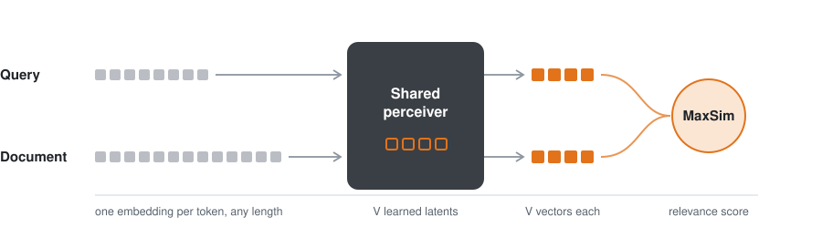

<p align="center">
  <picture>
    <source media="(prefers-color-scheme: dark)" srcset="assets/banner-dark.svg">
    
  </picture>
</p>

<p align="center">
  <a href="https://arxiv.org/abs/2610.27273"></a>
  <a href="https://huggingface.co/collections/himankhanda/flint-6ad3ac31fafcb692ae534c3b"></a>
  
  <a href="LICENSE"></a>
</p>

<p align="center">Himank Handa · Negar Arabzadeh · Matei Zaharia</p>

FLINT is a late-interaction retriever that pools every query *and* every document into the same small,
fixed number of vector embeddings. Storage and search cost stop growing with text length, which matters most
for long, complex queries.

## How it works

The encoder gives one embedding per token. Attention-based pooling uses **V** learned latents to turn those
into V vectors, so a short query and a long document both end up as V vectors.

<picture>
  <source media="(prefers-color-scheme: dark)" srcset="assets/architecture-dark.svg">
  
</picture>

## Results

<picture>
  <source media="(prefers-color-scheme: dark)" srcset="assets/highlights-dark.svg">
  
</picture>

## Usage

Install the requirements for the backbone you want (`requirements/bert.txt` or
`requirements/modernbert.txt`) and `requirements/eval.txt` for evaluation.

Training:

```bash
python scripts/prepare_msmarco_bert.py --out-dir data/msmarco
python scripts/train_flint_bert.py --data-dir data/msmarco

python scripts/prepare_msmarco_bge.py --out-dir data/msmarco-en-bge
python scripts/train_flint_modernbert.py --data-dir data/msmarco-en-bge --latents 32
```

Evaluation:

```bash
python scripts/evaluate.py --checkpoint <checkpoint> --benchmarks beir/scifact crumb/paper
python scripts/measure_latency.py --checkpoint <checkpoint> --benchmark crumb/paper
```

The baselines and other analysis scripts are in `scripts/`. Trained checkpoints are in this
[Hugging Face collection](https://huggingface.co/collections/himankhanda/flint-6ad3ac31fafcb692ae534c3b).

## Acknowledgements

This code is built on [ColBERT](https://github.com/stanford-futuredata/ColBERT). It is released under
the MIT license; `scripts/train_tokenlevel_modernbert.py` is adapted from
[ModernBERT](https://github.com/AnswerDotAI/ModernBERT) under Apache 2.0. The ConstBERT baseline
follows [MacAvaney et al. (2025)](https://huggingface.co/pinecone/ConstBERT).
